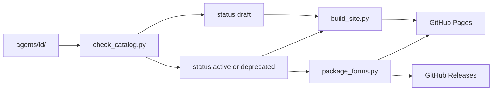

# Public agent catalog and GitHub Pages site

This is a proposal for review. It has not been built. It expands [site-design.md](site-design.md): a public repository and GitHub Pages site where people browse problem-creation agents and download the forms that are ready. Draft agents stay in the repo and are left off the download list.

The site is a reading catalog, not an app. It lists every published problem-creation agent, and each of those pages renders that agent’s README plus generated download buttons. Sample banks stay as files in the repo for now; the page only links to them. In-browser bank browsing can wait.

An agent folder can be labeled `draft` in `agent.yaml`. Draft means under construction: the folder stays in the repository, and the site does not offer it for download. No homepage download card, no agent page, and no zip. The homepage only names it under an “Under construction” heading.

Two agents exist today:

- Numerical calculation, from [`.cursor/skills/problem-creation`](.cursor/skills/problem-creation) and [`problem-creation agents/numerical calculation problems`](problem-creation%20agents/numerical%20calculation%20problems). This one is `draft`.
- Conceptual multiple choice, from [`.cursor/skills/multiple-choice-questions`](.cursor/skills/multiple-choice-questions) and [`problem-creation agents/multiple-choice questions`](problem-creation%20agents/multiple-choice%20questions). This one is `active` and is the first entry on the download list.

[`PHY I Mechanics`](PHY%20I%20Mechanics) stays where it is, as the worked example of bank format. [`input-form.html`](problem-creation%20agents/multiple-choice%20questions/input-form.html) is an input helper for the multiple-choice agent, not an API GUI. No API GUI form is published until one exists. The current [LICENSE](LICENSE) (CC BY-NC 4.0) stays as-is; the site only displays it. The root [README.md](README.md) already says that license will be revised later.

## Repository layout

Skills are not installed in this repo. [`.cursor/skills/`](.cursor/skills) is removed from git. A local install script can copy a Cursor form back into `.cursor/skills/` for development, and that directory stays gitignored.

```text
agents/
  numerical-calculation/
    agent.yaml
    README.md
    CHANGELOG.md
    examples/                 # input-scheme.yaml and sidecars
    design/                   # agent design plan.md (not in the zip)
    samples/                  # optional small generated banks
    forms/
      cursor/
        README.md             # unified form readme
        SKILL.md
        agents/
        scripts/
        requirements.txt
  multiple-choice/
    agent.yaml
    README.md
    CHANGELOG.md
    examples/                 # input file design, circular-motion sample, input-form.html
    design/
    forms/
      cursor/
        README.md
        SKILL.md
        agents/
        scripts/
        requirements.txt
scripts/
  check_catalog.py            # fails the build on schema or version drift
  package_forms.py            # writes dist/*.zip
  build_site.py               # writes _site/ from agents/*/agent.yaml + README.md
  install_local.py            # copies a Cursor form into .cursor/skills/<install_name>/
.github/workflows/pages.yml
PHY I Mechanics/              # unchanged format corpus
LICENSE
README.md                     # rewritten as the repo front door; points at the site
site-design.md                # kept as the original brief
```

Adding an agent later is a new folder under `agents/` with the same files. The homepage is generated by scanning those folders. No hand-edited agent list. A new folder is left off the download list until its `status` is `active` or `deprecated`.

Cursor install names stay `problem-creation` and `multiple-choice-questions`, matching the `name:` field already in each `SKILL.md`, so a user’s project still loads them from `.cursor/skills/<install_name>/`. Public ids (`numerical-calculation`, `multiple-choice`) are the catalog names and do not have to match the install folder.

Each zip is self-contained. The packager sets the archive root to the install folder and copies `examples/` in beside the skill. Design notes and PHY I banks stay out of the zip. Form READMEs that today point at `problem-creation agents/...` are rewritten to `examples/` paths that work inside the archive. Script paths inside `SKILL.md` keep assuming the skill is installed at `.cursor/skills/<install_name>/` in the user’s own project.

## Versioning

One convention for every agent. Versions are [semantic versions](https://semver.org): `MAJOR.MINOR.PATCH`.

- **MAJOR** — an existing input file no longer runs, or a workflow step changes meaning.
- **MINOR** — a new form, a new optional input field, or a backward-compatible capability.
- **PATCH** — prompt, script, or documentation fixes that leave inputs and outputs compatible.

The agent version lives only in `agent.yaml`. Each form has its own version in that same file. A form version may lag (Cursor at `0.2.0` while no ChatGPT form exists). A form with the same `MAJOR` as the agent reads that agent’s current input files. The multiple-choice agent is published at `0.1.0`. Numerical calculation is also versioned at `0.1.0` in the repo, and `status: draft` keeps that version off the site. `1.0.0` waits until the documented workflow is stable. Moving a draft onto the download list is a metadata change to `status: active`, not a new version by itself.

Git tag for a published agent release: `multiple-choice/v0.1.0`. Tag for a form released on its own: `multiple-choice-cursor/v0.1.0`. The site’s download button always packages the version written in `agent.yaml` on `main`. Older zips remain on GitHub Releases created from those tags, so a later bump does not erase them. A tag whose agent is `draft` does not get a Release or a Pages zip.

`scripts/check_catalog.py` fails if any of these drift:

- `agent.yaml` `version` and each `forms[].version` are not `MAJOR.MINOR.PATCH`
- a listed form has no `forms/<id>/` directory, or a directory exists that is not listed
- form `README.md` front matter `version` or `agent_version` disagrees with `agent.yaml`
- `CHANGELOG.md` has no heading for the current agent version
- `status` is missing or not one of `draft`, `active`, `deprecated`

`CHANGELOG.md` uses Keep a Changelog headings (`## [0.1.0] - YYYY-MM-DD`).

## Metadata and the unified form README

`agents/<id>/agent.yaml`:

```yaml
id: numerical-calculation
title: Numerical calculation problems
summary: Turns an equation scheme into reviewed scenarios and one calculation for every scenario and equation set.
problem_type: numerical
version: 0.1.0
status: draft   # draft | active | deprecated
authors:
  - name: Zhongzhou
    role: author
    url: https://github.com/Zhongzhou
license: CC-BY-NC-4.0
forms:
  - id: cursor
    title: Cursor skill
    version: 0.1.0
    install_name: problem-creation
samples:
  - title: Example input scheme
    path: examples/input-scheme.yaml
```

`status` is the publication label:

- `draft` — under construction. Stored in the repo. Named on the homepage under “Under construction”. Omitted from download cards, agent pages, Pages zips, and Releases.
- `active` — on the download list, with an agent page and zip buttons. Multiple choice uses this.
- `deprecated` — still on the download list, with that word shown on the card and the agent page.

Form ids are a short vocabulary: `cursor`, `codex`, `chatgpt`, `gui`. A form that is not on disk is omitted, not shown as unavailable. `samples` may be empty. Draft agents keep the same form README shape so the folder is ready to publish later. `install_local.py` can still copy a draft Cursor form into `.cursor/skills/` for work in this clone. That local copy is not a public download.

Every form `README.md` starts with the same front matter, then the same sections in the same order:

```yaml
---
agent: numerical-calculation
form: cursor
version: 0.1.0
agent_version: 0.1.0
authors:
  - name: Zhongzhou
    role: author
license: CC-BY-NC-4.0
updated: 2026-10-30
---
```

Sections: what this form is, requirements, install, how to run, input files, version (link to the agent changelog), authors, license. The agent-level `README.md` is the detail-page body: what the agent generates, what it does not do, and the workflow. It does not hard-code download URLs. The site inserts those from `agent.yaml`.

## How a download is built



`package_forms.py` writes `dist/<id>-<form>-<version>.zip` (gitignored) for agents whose `status` is `active` or `deprecated`. It skips `draft`. Zip root is `<install_name>/` and includes `README.md`, the skill files, `requirements.txt`, and `examples/`. It excludes `design/`, tests cache, and `__pycache__`.

Current zips are uploaded with the Pages site at `/downloads/<id>-<form>-<version>.zip`. A tag push runs the same packager and attaches those zips to a GitHub Release only when the tagged agent is not `draft`. The agent page links the Pages zip for the current version and links the Releases list for history.

## Site pages

GitHub Pages deploys from GitHub Actions, not from the branch. A branch-based Jekyll build would try to process the PHY I YAML tree. The workflow runs the checker, packager, and site builder, uploads `_site/`, and deploys with `actions/deploy-pages`. Owner and repo come from `git remote` so download and sample links stay valid. Local preview is `py -3 scripts/build_site.py` and a static server on `_site/`.

Visual system matches the paper palette already in the multiple-choice input form: paper `#fffcf7`, ink `#1c1915`, muted `#5c564e`, line `#d9d3c8`, accent `#1f4b3a`. System sans-serif, 16px body, content column about 52rem, one accent used for links and the download button. Light color scheme, visible focus, buttons at least 44px tall. No framework and no client-side catalog.

**Home (`/`)**

- Header: “Isomorphic problem-bank agents”, a link to the GitHub repository.
- Lede: open repository of agents that generate isomorphic physics problem banks. Agents are downloaded and installed in the user’s own project. This site does not run them.
- Download list: one card per `active` or `deprecated` agent, in `id` order. Each card shows title, version, one-sentence summary, author names, a chip per form (`Cursor skill`), and “Deprecated” when that is the status. One button: “View and download”, to `/agents/<id>/`.
- Under construction: `draft` agents only. Each line shows the title, the summary, and the label “Draft”. No button, no version chip, and no link to a page or zip. With the current catalog this section contains numerical calculation and nothing else.
- A short “Problem bank format” note: name pattern `Subject-Unit-Abbreviation_of_title-mmddyy`, with a link to `PHY I Mechanics/` on GitHub and to [Topics.csv](PHY%20I%20Mechanics/Topics.csv).
- Footer: license name linking to `LICENSE` on GitHub, and a line that sample banks illustrate format.

**Agent page (`/agents/<id>/`)**

Generated only for `active` and `deprecated` agents. A `draft` id has no page.

- Title, version, “Deprecated” when that is the status, authors as links when `url` is set.
- Rendered agent `README.md`.
- Downloads panel generated from `forms`, not from the README. Each row: form title, form version, install path (`.cursor/skills/problem-creation/`), and a button “Download Cursor skill 0.1.0 (.zip)”. Under the buttons, a “Older versions” link to GitHub Releases.
- Samples: file name and a link to the file on GitHub. If `samples` is empty, the section says a sample bank has not been added. No bank renderer in this version.
- Changelog: the current version’s `CHANGELOG.md` section, plus a link to the full file on GitHub.

**No other pages.** Install steps live in the form README inside the zip and are summarized in the downloads panel (unzip into the user’s project so the skill folder sits at the install path, then ask that platform to run the workflow).

## Root README

Replace the current “skills are installed here” instructions with: what the repo is, link to the Pages site, which agents are published, and which are draft. Numerical calculation is named as under construction and not offered for download. Explain how to add an agent (copy the folder shape, set `status`, bump the version, push) and where PHY I Mechanics and the license sit. Keep the bank filename convention. Drop the `.venv` setup that assumes skills live in this clone; that setup moves into each form README for the user’s own project.

## Publish steps

After the files land on `main`: make the GitHub repository public, enable Pages with source “GitHub Actions”, and confirm the workflow URL. Do not change license text in this work. Do not commit `dist/`, `_site/`, or `.cursor/skills/`.

## Work this proposal implies

1. Move the two Cursor skills, examples, and design notes into `agents/<id>/` with `agent.yaml`, `README.md`, and `CHANGELOG.md`. Gitignore `.cursor/skills` and add `install_local.py`.
2. Add the shared form README front matter and sections, set both agents to `0.1.0`, and make `check_catalog.py` enforce semver and changelog alignment.
3. Write `package_forms.py` so each published form zip is self-contained and rooted at the Cursor install name. Skip agents whose status is `draft`.
4. Build the static home and agent pages from published agents only. Label draft agents as under construction and give them no download link or agent page.
5. Add the GitHub Actions workflow that checks, packages, and deploys `_site`, and document the public-repo and Pages settings plus release tags.
6. Rewrite the repository README so it introduces the catalog and stops telling visitors to install skills inside this clone.
